# LinkMap

LinkMap is a small C++20 command-line analyzer for ELF relocatable object files. It reads ELF metadata, sections, symbols, and relocations, then explains selected symbol relationships across the object files you provide. It does not link files or execute them.

Separate compilation turns each C/C++ translation unit into an object file. Each object can contain code/data sections, symbol records describing definitions and references, and relocation entries describing places that need linker attention. LinkMap makes those relationships visible when a build fails with an undefined or multiply defined symbol.

## Build

Requirements: CMake 3.20+, a C++20 compiler, and Python 3 for compiler-generated integration tests. No third-party C++ library is required.

```sh
cmake -S . -B build -DCMAKE_BUILD_TYPE=Release
cmake --build build
ctest --test-dir build --output-on-failure
```

If CMake selects a broken or incomplete compiler installation, set `-DCMAKE_CXX_COMPILER=/path/to/clang++` explicitly.

## Commands

```sh
linkmap inspect build/main.o
linkmap sections build/main.o
linkmap symbols build/main.o
linkmap relocations build/main.o
linkmap analyze build/main.o build/math.o
linkmap analyze build/main.o build/math.o --format json --output report.json
linkmap inspect build/main.o --verbosity verbose
linkmap graph build/main.o build/math.o                 # Graphviz DOT
linkmap graph build/main.o build/math.o --symbol add_values
linkmap version
linkmap help
```

`analyze` reports unresolved global/weak references within the supplied set and duplicate strong global definitions. An unresolved finding may be satisfied by an omitted object, archive, shared library, or startup object. The tool does not model archive extraction, search order, linker scripts, symbol versioning, COMDAT selection, dynamic loading, or the complete visibility and common-symbol rules of GNU ld/LLD.

`--verbosity quiet|normal|verbose` controls text detail; quiet suppresses the diagnostic listing, while verbose adds ELF header details. JSON remains complete and machine-readable at every verbosity level.

### Example

`tests/fixtures/source/main.c` calls `add_values`, which is defined in `math.c`. When separately compiled, the caller has an undefined symbol and a relocation; the provider has a global definition. The analyzer reports an object dependency from the caller to the provider. The fixture compiler command used by CTest is equivalent to:

```sh
clang --target=x86_64-unknown-linux-gnu -std=c11 -c tests/fixtures/source/main.c -o main.o
clang --target=x86_64-unknown-linux-gnu -std=c11 -c tests/fixtures/source/math.c -o math.o
build/linkmap analyze main.o math.o
```

Text reports list input format, sections/symbols/relocations for the selected command, graph summary, and diagnostics. JSON output has `schema_version: 1` and includes input metadata, sections, symbols, relocations, dependencies, and diagnostics. DOT uses stable `object_N` IDs; `--symbol NAME` produces a symbol relationship view.

Representative text output for the two-object fixture:

```text
Cross-Object Resolution
  Dependencies: 1  unresolved references: 0  duplicate strong symbols: 0  weak definitions: 0
  object[0] -> object[1] via add_values
```

The same relationship appears in JSON as:

```json
{"schema_version":1,"object_dependencies":[{"source":0,"target":1,"symbol":"add_values","relocation_section":4,"offset":5}]}
```

Section indexes and offsets depend on compiler output; the excerpt shows the report shape rather than a cross-tool golden file. See [report-format.md](docs/report-format.md) for the complete schema field list.

## ELF model and compatibility

The initial supported parser accepts ELF64, little-endian, `ET_REL` files. It parses generic section/symbol/relocation records for any machine ID and provides named relocation descriptions only for selected x86-64 relocation types. ELF32, big-endian ELF, executables/shared objects, extended section numbering, and extended symbol section indexes are unsupported. Unknown relocation types are retained numerically. Section payloads are bounds-checked; `SHT_NOBITS` has no file payload.

Offsets in relocatable objects are interpreted in their target-section context, not as final virtual addresses. LinkMap does not apply relocations or produce an executable. See [supported scope](docs/elf-overview.md), [limitations](docs/limitations.md), and [security notes](docs/security.md).

## Compare with system tools

If LLVM's `llvm-readelf` is available, run:

```sh
scripts/compare_elf_tools.sh build/linkmap
```

The script compiles the source fixtures, checks LinkMap's JSON facts against `llvm-readelf` header/section/symbol/relocation output, and reports missing tools. GNU `readelf`, `nm`, and `objdump` are useful additional references:

```sh
readelf -h -S -s -r main.o
nm -C main.o
objdump -r main.o
```

## Architecture

```mermaid
flowchart LR
  A[ELF input files] --> B[Checked byte reader]
  B --> C[ELF header parser]
  C --> D[Section parser]
  D --> E[Symbol parser]
  E --> F[Relocation parser]
  F --> G[Cross-object symbol index]
  G --> H[Resolution diagnostics]
  H --> I[Dependency graph]
  I --> J[Text / JSON / DOT reports]
```



The implementation details and phase record are in [docs/architecture.md](docs/architecture.md) and [IMPLEMENTATION_STATUS.md](IMPLEMENTATION_STATUS.md). Further topic guides cover ELF, parsing, sections, symbols, relocations, resolution, graphs, diagnostics, validation, and [interview notes](docs/interview-notes.md).

## Security and license

Inputs are treated as untrusted bytes, read-only, and never executed. Table counts, ranges, links, indexes, and string termination are checked. File inputs are limited to 512 MiB. Output files are not overwritten. See [security.md](docs/security.md).

LinkMap is distributed under the MIT License. It has no runtime library dependencies beyond the C++ standard library.
